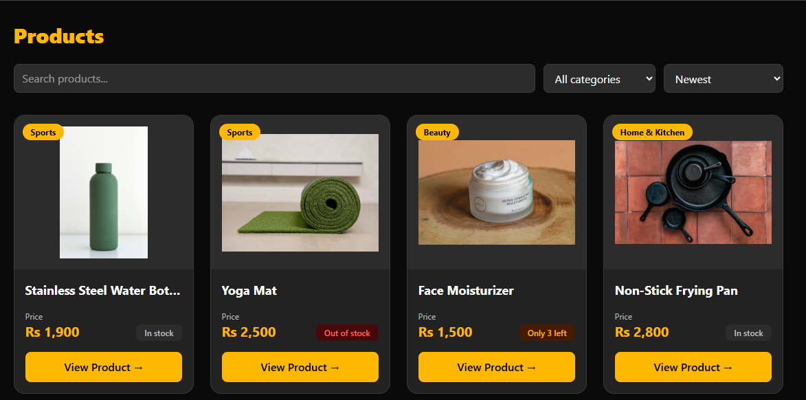
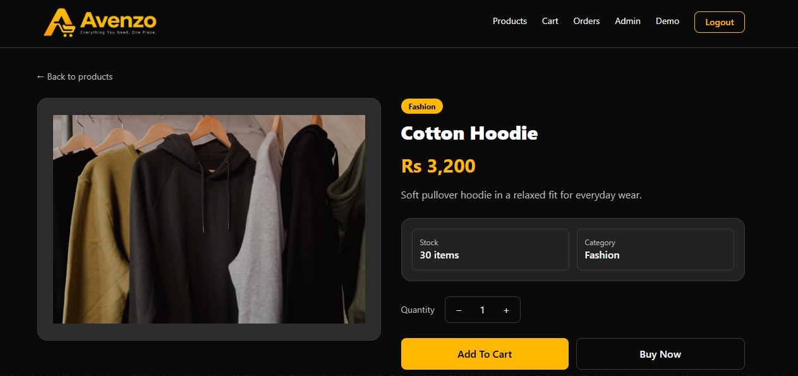
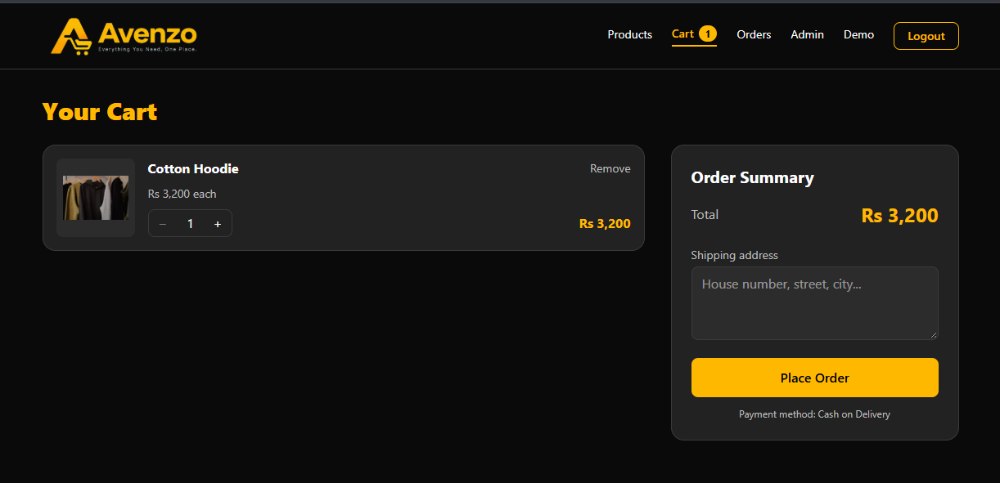
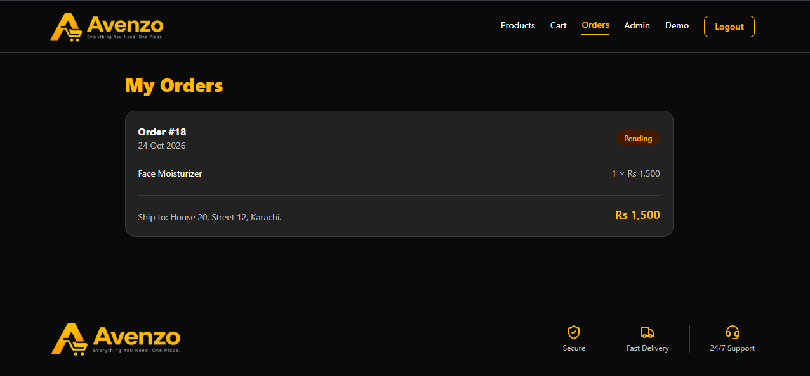
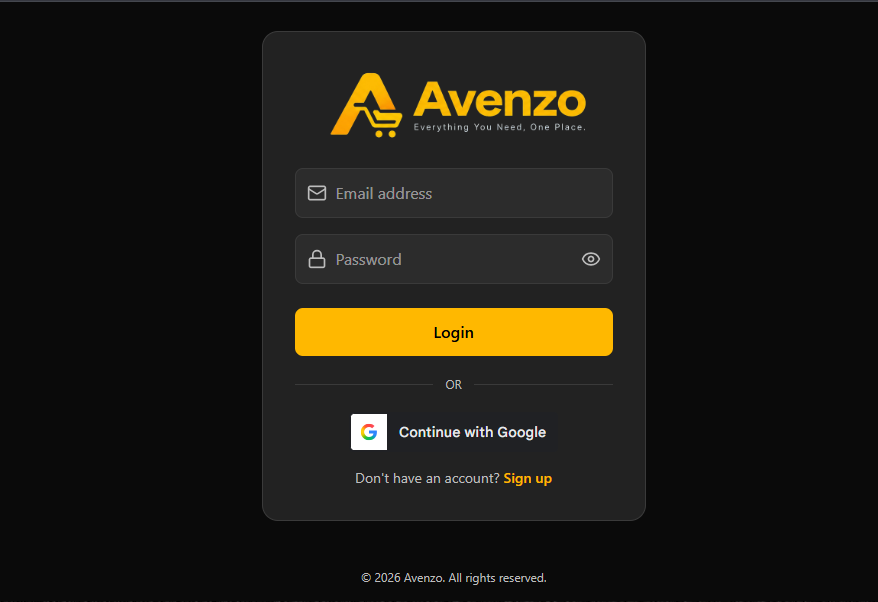
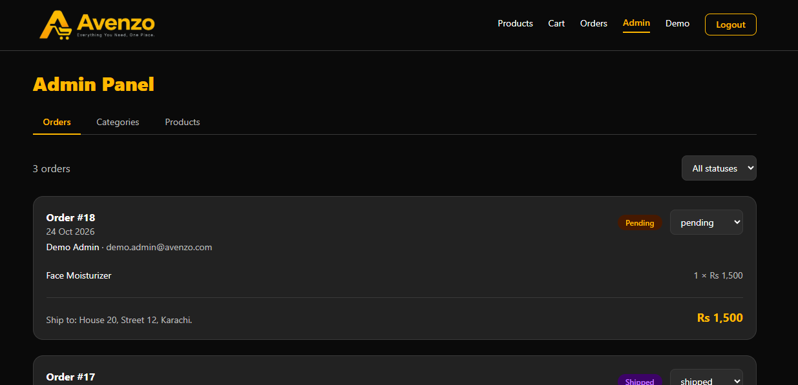

# Avenzo - Full-Stack E-Commerce App

> Everything You Need, One Place.

Avenzo is a full-stack e-commerce web application. Customers can browse products, add them to a cart and place orders, while admins manage products, categories and orders from a dedicated panel.

## Live Demo

- **Frontend:** https://avenzo-plum.vercel.app/
- **Backend API:** https://avenzo-ecommerce.vercel.app/

### Demo accounts

Use these accounts to explore the app without signing up:

| Role | Email | Password |
| --- | --- | --- |
| Customer | `demo.user@avenzo.com` | `Demo@1234` |
| Admin | `demo.admin@avenzo.com` | `Demo@1234` |

> The admin account has full access (add, edit and delete products, categories and orders). Please be gentle with the data.

> Google sign-in is currently in Google's testing mode, so only approved test accounts can use it. Everyone else can use the demo accounts above or create an account with email and password.

## Screenshots

| Products | Product Detail |
| --- | --- |
|  |  |

| Cart | Orders |
| --- | --- |
|  |  |

| Login | Admin Panel |
| --- | --- |
|  |  |

## Features

**Customers**
- Sign up, log in and log out with JWT stored in an httpOnly cookie (passwords hashed with bcrypt)
- "Continue with Google" sign-in (Google ID token verified on the backend, existing accounts are linked by email)
- Browse products with debounced search, category filter, sorting and pagination
- Product detail page with quantity selector, Add to Cart and Buy Now
- Cart with quantity updates, item removal, live item count in the navbar and a shipping address at checkout
- Place orders (Cash on Delivery) and track their status
- Profile page to update name and phone, or deactivate the account
- Responsive layout with a mobile navigation menu and a custom 404 page

**Admin**
- Role-based admin panel (admin-only routes on both frontend and backend)
- Orders: view all orders, filter by status, update status, cancel (stock is restored automatically)
- Products: add, edit and delete, with image upload to Cloudinary
- Categories: add, rename and delete

**Engineering highlights**
- Checkout runs inside a PostgreSQL transaction (create order, decrement stock, clear cart), with row locking to prevent overselling
- The price is copied into each order item, so later price changes never alter past orders
- All SQL uses parameterized queries (no string concatenation), preventing SQL injection
- Foreign keys protect data integrity: a category with products or a product in an order cannot be deleted
- Security middleware: `helmet`, request body size limit and rate limiting (stricter on login and signup)
- Frontend data caching with TanStack Query, with cache invalidation after every change that affects the data
- Admin-only image upload (multer in memory + Cloudinary), compatible with serverless hosting

## Tech Stack

| Layer | Technology |
| --- | --- |
| Frontend | React, Vite, Tailwind CSS v4, React Router, TanStack Query, Axios, react-hot-toast, lucide-react |
| Backend | Node.js, Express (ES modules), JWT, bcrypt, Google OAuth (google-auth-library), multer, helmet, express-rate-limit |
| Database | PostgreSQL on Neon (plain `pg`, no ORM) |
| Media | Cloudinary |
| Deployment | Vercel (frontend and backend) |

## API Overview

| Route group | Access | Description |
| --- | --- | --- |
| `/api/auth` | Public | Sign up, log in, Google sign-in, log out |
| `/api/profile` | Logged in | Get, update and deactivate own profile |
| `/api/categories` | GET public, others admin | List, add, rename, delete |
| `/api/products` | GET public, others admin | List (search, filter, sort, pagination), detail, add, edit, delete |
| `/api/cart` | Logged in | Get cart, add item, update quantity, remove item |
| `/api/orders` | Logged in / admin | Checkout, my orders, all orders and status update (admin) |
| `/api/upload` | Admin | Upload a product image to Cloudinary |

## Run Locally

### 1. Backend

```bash
git clone <backend-repo-url>
cd <backend-folder>
npm install
```

Create a `.env` file:

```env
PORT=5000
PGHOST=your-neon-host
PGDATABASE=your-db-name
PGUSER=your-db-user
PGPASSWORD=your-db-password
PGPORT=5432
JWT_SECRET=a-long-random-string
CLOUDINARY_CLOUD_NAME=your-cloud-name
CLOUDINARY_API_KEY=your-api-key
CLOUDINARY_API_SECRET=your-api-secret
GOOGLE_CLIENT_ID=your-google-oauth-client-id
```

```bash
npm run dev
```

The API runs on `http://localhost:5000`.

### 2. Frontend

```bash
git clone <frontend-repo-url>
cd ecommerce-client
npm install
```

Create a `.env` file in the frontend root:

```env
VITE_GOOGLE_CLIENT_ID=your-google-oauth-client-id
```

```bash
npm run dev
```

The Vite dev server proxies `/api` to `http://localhost:5000`.

## Future Improvements

- Product reviews and ratings
- Let customers cancel their own orders
- Admin dashboard with sales statistics
- Online payments

## Author

**Shayan Malik**

- GitHub: https://github.com/your-username
- LinkedIn: https://linkedin.com/in/your-profile